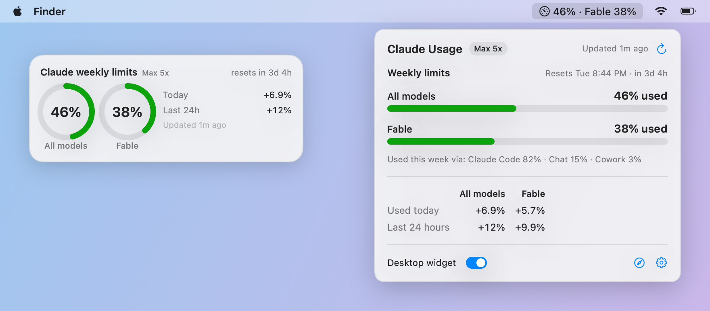

# Claude Usage

A tiny native macOS app that shows your **Claude weekly usage limits** at a glance — in the menu bar and as a desktop widget.

<picture>
  <source media="(prefers-color-scheme: dark)" srcset="docs/showcase-dark.png">
  
</picture>

<sub>Screenshots use demo data.</sub>

## Features

- **Menu bar label** — `46% · Fable 38%`: the all-models weekly limit, plus the per-model weekly limit (e.g. Fable).
- **Popover** — each weekly limit with a progress bar, when it resets, where usage came from (Claude Code / Chat / Cowork), and how much you used **today** and in the **last 24 hours**.
- **Desktop widget** — rings for each limit. Sits on the desktop behind your windows by default; right-click to make it always-on-top, hide it, or quit. Drag to move.
- Colors go green → yellow → orange → red as a limit fills up.
- Refreshes every 30 minutes by default (1 min – 1 h in the gear menu), on wake from sleep, and when you open the popover if the data is more than 5 minutes old. Backs off automatically if Anthropic rate-limits the check.
- Native SwiftUI, no dependencies, ~1 MB.

## Requirements

- macOS 14 (Sonoma) or later
- [Claude Code](https://docs.claude.com/en/docs/claude-code) installed and signed in with a Claude subscription (Pro / Max) — the app reuses that login
- Xcode Command Line Tools (`xcode-select --install`) to build

## Install

```bash
git clone https://github.com/wshuai294/claude-usage-meter.git
cd claude-usage-meter
./build.sh --install            # builds and installs to ~/Applications/"Claude Usage.app", then launches it
./build.sh --install ~/Desktop  # or put the app somewhere else
```

The app lives in the menu bar (no Dock icon). Double-click the app again to bring back a hidden widget. Turn on **Launch at login** in the gear menu so usage history keeps building up.

## How it works

- **Usage numbers** come from the same endpoint `claude /usage` uses (`api.anthropic.com/api/oauth/usage`), authenticated with the OAuth token Claude Code keeps in your login keychain (`Claude Code-credentials`).
  - The token is read with `/usr/bin/security`, held only in memory, and sent only to `api.anthropic.com`.
  - The app never refreshes or writes the token itself. If it has expired, it runs `claude -p /usage` so Claude Code refreshes it the normal way (this makes no model call and uses no quota).
- **Today / last 24 hours** — Anthropic only reports the current percentage, so the app records it at each refresh and computes the increase. History starts when you first run the app.
- **Local files** (in `~/Library/Application Support/ClaudeUsage/`): `history.json` (percentages over the last 15 days) and `last-usage.json` (the last response, so a restart shows numbers immediately). Nothing else is stored and there is no telemetry.

> This is an unofficial tool, not affiliated with Anthropic. It relies on an undocumented endpoint that may change.

## Development

```bash
./build.sh                                                        # build/ClaudeUsage.app
build/ClaudeUsage.app/Contents/MacOS/ClaudeUsage --snapshot out --demo   # render screenshots with demo data
```

`--snapshot <dir>` without `--demo` renders your real data instead.

| File | |
|---|---|
| `Sources/PlanUsageService.swift` | keychain read, API call, CLI fallback, response cache |
| `Sources/UsageStore.swift` | refresh timers, back-off, app state |
| `Sources/History.swift`, `Insights.swift` | recorded percentages → today / last 24 hours |
| `Sources/PopoverView.swift`, `Widget.swift`, `Components.swift` | UI |
| `Sources/Snapshot.swift` | screenshot / demo mode |
